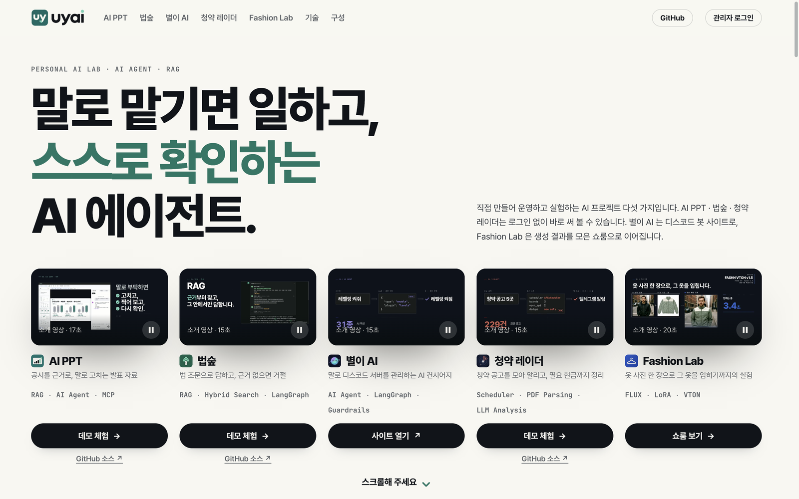

<h2 align="center">장우영 · U Yeong Jang</h2>

<b>LLM · VLM 애플리케이션 개발자</b> - 에이전트와 백엔드를 만들고, 결과를 측정해 고칩니다.

<h3 align="center"><a href="https://uyai.imoneleft.synology.me/">포트폴리오 · 라이브 데모 보기 →</a></h3>

금융 태블릿 창구 앱(Android)을 3년 만든 뒤, 문서 인식(VLM + OCR) · RAG · AI 에이전트 서비스로 옮겨 왔습니다. 모바일부터 프론트 · 백엔드 · 인프라 · LLM 서빙까지 직접 만들고, 바꿀 때마다 같은 기준으로 재서 결정합니다.

### 대표 프로젝트

| 프로젝트 | 무엇 | 기술 |
|---|---|---|
| [**법숲**](https://github.com/Nelef/beopsoop) | 일상의 말로 묻고 법 조문으로 답하는 한국 법령 RAG - 근거 없으면 답하지 않음, 검색 hit@5 0.90 | Node.js · bge-m3 · LangGraph · MCP |
| [**DART Deck**](https://github.com/Nelef/dart-deck) | 말로 만들고 말로 고치는 발표 자료 - Claude Code 에이전트가 덱을 쓰고 화면을 찍어 스스로 확인 | Python · Claude Code · MCP · PPTX |
| [**청약 레이더**](https://github.com/Nelef/chungyak-radar) | 서울 · 경기 청약 공고 수집, 텔레그램 알림, 필요현금 · 통근시간 계산 | FastAPI · APScheduler · Docker |
| [**Fold/Lab**](https://github.com/Nelef/foldlab) | 폴더블 폰을 브라우저에서 접고 펴 보는 3D 실험실 - [데모](https://nelef.github.io/foldlab/) | Three.js |

### 기술

이전 모바일 포트폴리오: [nelef.github.io/portfolio](https://nelef.github.io/portfolio/)
